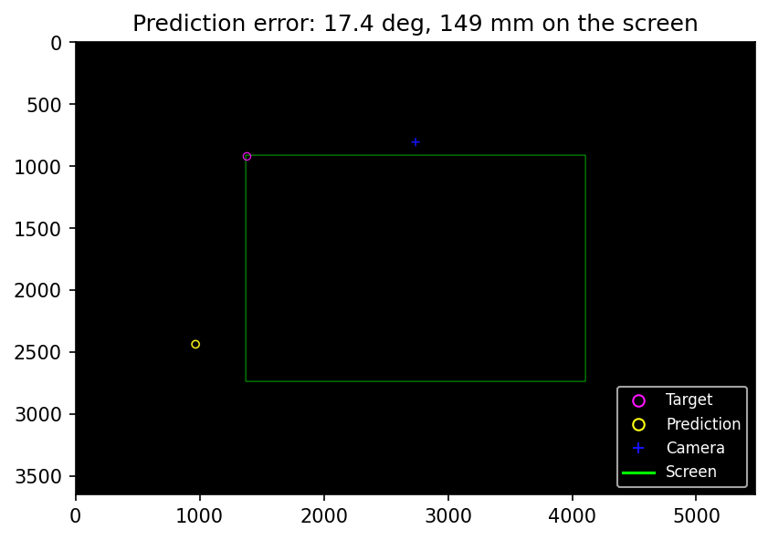
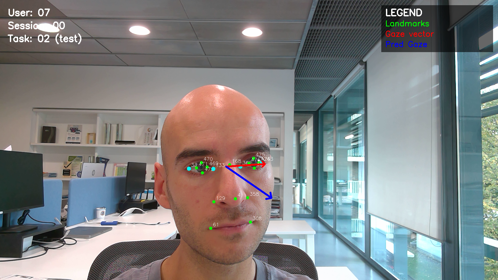
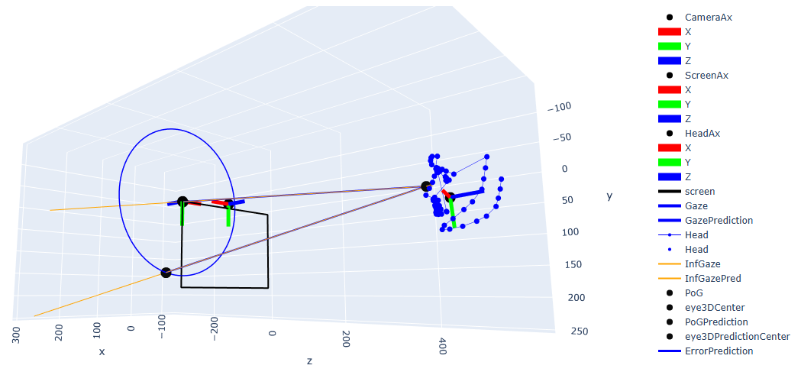
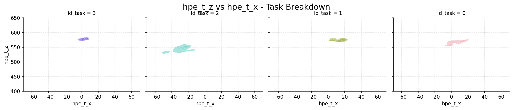
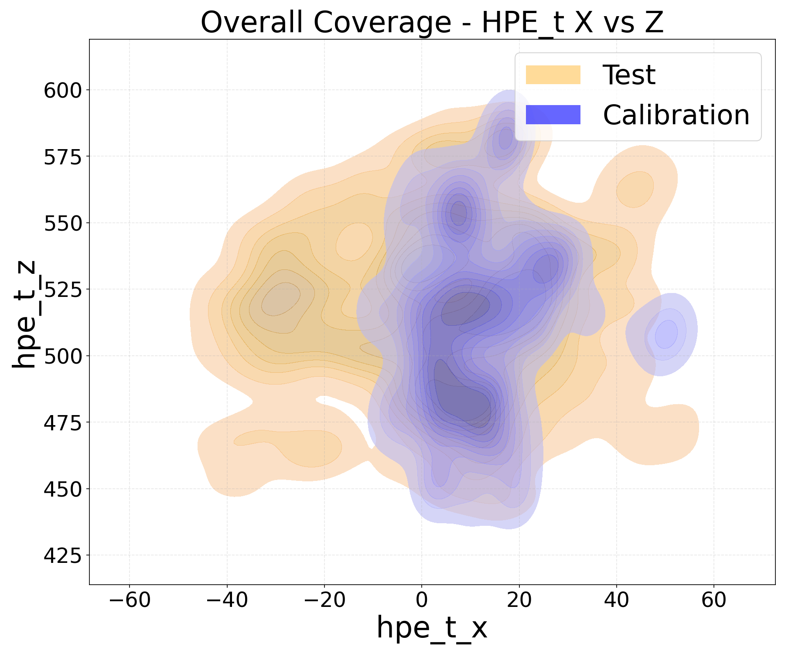
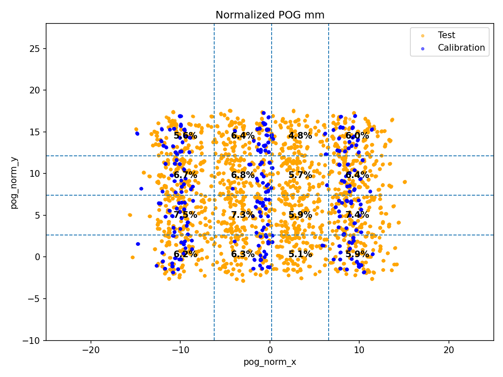

# Visualization

Tools to inspect single samples and the distributions of the dataset. Run them from the repository root; they find their bundled data and configuration files on their own.

```bash
python -m pip install -r requirements-visualization.txt
```

## `explore_dataset.py`: dataset overview

Builds a self-contained interactive HTML report from the bundled `recalib_index.csv`, so it works without the restricted images. It has cascading participant, session and task filters, exact sample counts, longitudinal session coverage and a per-session breakdown (Overview tab), and the screen-target, head-rotation and head-position distributions per task (Sample distributions tab). The screen-target panel acts as a cross-filter for the rest of the report.

```bash
python visualization/explore_dataset.py                 # writes temp/recalib_dataset_explorer.html
python visualization/explore_dataset.py --open          # and opens it
python visualization/explore_dataset.py --id-user 7 --id-session 13 --output results/explorer.html
```

Head-pose plots use a deterministic subsample to keep the report responsive; counts and screen-target coverage are exact. See `--help` for all options.

## `visualize_sample.py`: one sample

Shows the labels of one image: the target and gaze intersection on the screen, the landmarks, eye regions and gaze vector over the image, and an interactive 3D view of the camera, screen, head pose and gaze ray. By default it opens the bundled example (`example/07_00_02_img-0039.png`); any other `.png`/`.jpg` with a same-named `.json` can be given.

```bash
python visualization/visualize_sample.py
python visualization/visualize_sample.py path/to/sample.png
python visualization/visualize_sample.py --no-display        # non-interactive check
python visualization/visualize_sample.py --save-dir docs/assets   # write the three views instead of displaying them
```

With `--save-dir` the 3D view is written as interactive HTML, and also as PNG when plotly's image export (`kaleido`) is installed. The figures below were made this way from the bundled example, with the ETH-XGaze prediction (`--checkpoint evaluation/ckpt/epoch_24_ckpt.pth.tar --save-dir docs/assets`); the 3D PNG is a screenshot of the HTML. The 2D screen view shows the target, the predicted point of gaze and the camera, with the angular and on-screen error. The prediction is zero-shot, so its error (17° here) is not a measure of the labels.

Optionally it overlays the prediction of an ETH-XGaze model and reports its angular error. This needs the full `requirements.txt` and the checkpoint linked in `evaluation/ckpt/readme.txt`:

```bash
python visualization/visualize_sample.py --checkpoint evaluation/ckpt/epoch_24_ckpt.pth.tar
```

| 2D screen view | Image overlay | Interactive 3D view |
| :---: | :---: | :---: |
|  |  |  |

## `main_gaze_visualization.py`: distributions of a participant, session or task

Histograms, KDE heat maps and scatter plots of head pose, gaze vectors and gaze intersections, comparing calibration and test tasks, the sessions of a participant, or the tasks of a session. Reads `recalib_index.csv` (participant 7 by default) and exports the figures and a filtered CSV to `temp/`.

```bash
python visualization/main_gaze_visualization.py
python visualization/main_gaze_visualization.py --id-user 7 --id-session 13 --id-task 0
python visualization/main_gaze_visualization.py --all-users --no-plots --no-export
```

| Session 13 of participant 7, per task: `hpe_t_z` vs `hpe_t_x` | Participant 7, calibration vs test: `hpe_t_z` vs `hpe_t_x` | Participant 7: normalized PoG |
| :---: | :---: | :---: |
|  |  |  |

These come from `--id-user 7 --id-session 13` (`hpe_t_z_vs_hpe_t_x_task_breakdown.png`) and `--id-user 7` (`overall_coverage_hpe_t_x_vs_z.png`, `normalized_pog_mm.png`). Only samples kept after quality filtering are plotted; axis limits are set in `gaze_analyisis_params.yaml`.

## `explore_statistical_analysis.py`

Interactive explorer of the report written by `statistical_analysis` (see [`../statistical_analysis/README.md`](../statistical_analysis/README.md)).
